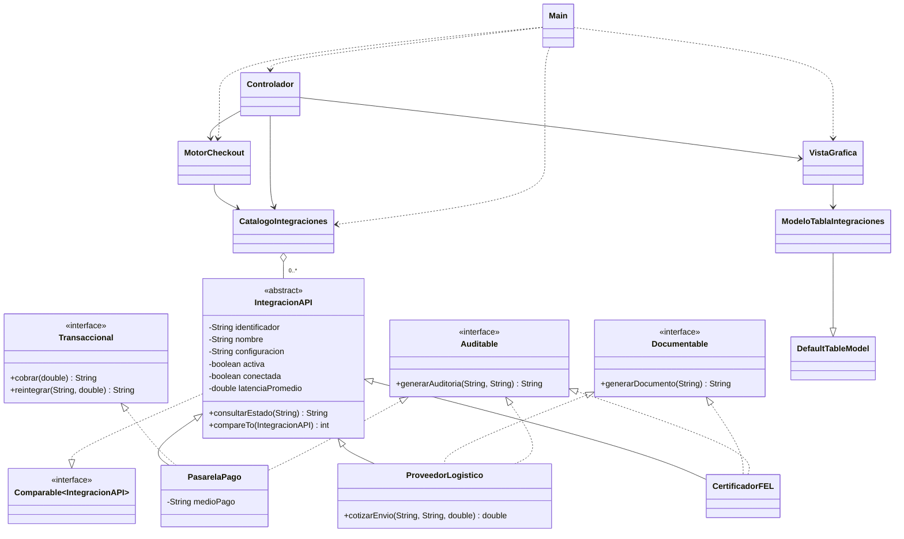

# Ejercicio 6: catálogo de integraciones API

Aplicación Java con servicios simulados de pagos, logística y facturación FEL.
Usa una lista polimórfica, interfaces por capacidad, ordenamiento con `Comparable`
y separación del modelo, la vista Swing y el controlador. No necesita dependencias externas.

## Ejecutar

Desde la raíz del proyecto, con JDK 17 o posterior:

```sh
mkdir -p out
javac -encoding UTF-8 -d out src/*.java
java -cp out Main
```

La aplicación requiere un entorno gráfico. Seleccione una fila o escriba un identificador; use Buscar para ver
la configuración. Elija la operación, complete los campos y pulse Ejecutar.
Los números usan punto decimal y los identificadores distinguen mayúsculas.

Se cargan diez integraciones: `PAG-01` a `PAG-04`, `LOG-01` a `LOG-03`
y `FEL-01` a `FEL-03`. `PAG-04` está inactiva y `LOG-03` desconectada
para poder comprobar las validaciones. El listado muestra solo las activas;
la búsqueda permite consultar cualquiera del catálogo.

Los cobros, estados, guías y facturas son simulados, sin conexión a proveedores.
Los reintegros validan una referencia no vacía, sin llevar un registro contable
de cobros. La cotización usa Q 25 de base más Q 5 por kilogramo. Los documentos
reciben una descripción no vacía con los datos del envío o de facturación;
el análisis no especifica un esquema obligatorio. El XML FEL no tiene validez fiscal.
La auditoría describe la acción solicitada y se adjunta a los resultados;
no se conserva un historial persistente.

## Clases



Para agregar un proveedor con las mismas capacidades, registre otra instancia
de la clase correspondiente. Para cambiar su comportamiento, herede de
`IntegracionAPI` e implemente las interfaces que correspondan. El motor comprueba
`Transaccional`, `Documentable` y `Auditable` antes de ejecutar; las cotizaciones
se ofrecen a `ProveedorLogistico` y sus subclases.

Los eventos se manejan con métodos de `ActionListener` y `ListSelectionListener`.
`Controlador` recibe las acciones de los botones y `VistaGrafica` atiende los cambios
del formulario y la selección de filas. `Main` implementa `Runnable` para iniciar
Swing en su hilo de eventos. La clase `ModeloTablaIntegraciones` define las columnas
y evita que se editen las celdas. La conversión del texto a números se realiza en
el controlador; el motor valida las capacidades, la disponibilidad y los datos de las operaciones.
